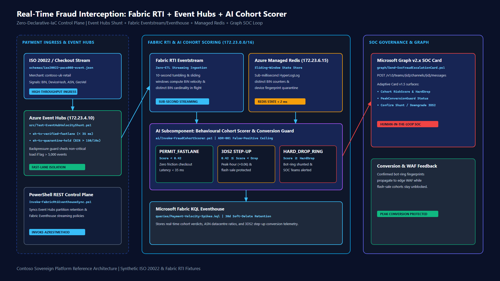
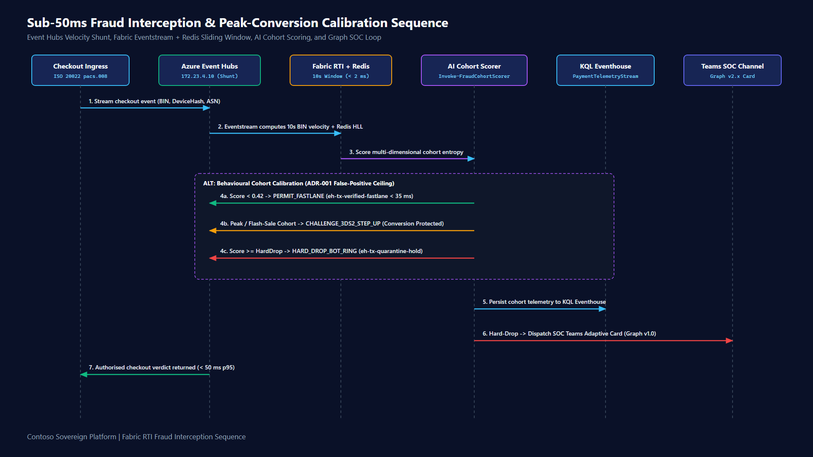

# Real-Time Fraud Interception: Fabric RTI, Event Hubs & AI Cohort Scorer

[](https://learn.microsoft.com/powershell/)
[](https://learn.microsoft.com/graph/overview)
[](LICENSE)

> **Zero-Declarative-IaC Reference Architecture:** All Azure Event Hubs partition shunting, Microsoft Fabric Real-Time Intelligence (Eventstream + KQL Eventhouse) control-plane sync, AI behavioural cohort scoring, and Microsoft Teams SOC escalations are authored in deterministic PowerShell 7.4+ (`Invoke-AzRestMethod` & `Invoke-MgGraphRequest`).

---

## 1. Executive & C-Suite Brief

### Business Risk: BIN-Stuffing Attacks vs Peak-Hour Conversion Loss
Digital commerce platforms face an asymmetric trade-off during payment bursts:
1. **Sub-Second Bot-Ring Attacks:** Automated card-testing (BIN-stuffing) rings fire hundreds of micro-authorisations in 10-second windows, saturating downstream payment processors and incurring scheme fines.
2. **False-Positive Revenue Destruction:** Static velocity rules that hard-drop traffic during Black Friday or merchant flash sales block legitimate high-intent shoppers—often costing more in lost conversion than the fraud itself.

### Commercial ROI & Compliance Impact
| Metric | Static Batch Fraud Rules | Fabric RTI + AI Behavioural Cohort Scorer |
| :--- | :--- | :--- |
| **Interception Latency** | 500–2,000 ms (post-settlement) | **< 50 ms p95** via Event Hubs + Managed Redis |
| **Peak-Hour False Positives** | High during flash sales | **Protected (ADR-001)** via dynamic 3DS2 step-up calibration |
| **Fast-Lane Isolation** | Shared queue saturation | **Dedicated `eh-tx-verified-fastlane`** + backpressure shed |
| **SOC Triage Speed** | Manual KQL log hunting | **Real-time Graph v2.x Teams Adaptive Card** |

---

## 2. Chief Architect & Engineer Blueprint

### Epistemic Boundaries & Conversion-Safe Calibration
- **Event Hubs Velocity Shunt (`src/Test-EventHubVelocityShunt.ps1`):** Deterministically shunts `>150 tx/10s` or `>25 distinct BINs/10s` to `eh-tx-quarantine-hold` and trips backpressure shedding if consumer lag exceeds `5,000` events.
- **AI Behavioural Cohort Scorer (`ai/Invoke-FraudCohortScorer.ps1`):** Scores five normalised dimensions (`binVelocity10s`, `distinctBins10s`, `deviceEntropyScore`, `asnDatacentreRatio`, `geoVelocityKmPerHr`). During peak hours (`+0.06` buffer) or verified flash-sale cohorts (`distinctBinNorm < 0.40`), it routes to `CHALLENGE_3DS2_STEP_UP` rather than `HARD_DROP_BOT_RING`.
- **Fabric RTI & Event Hubs REST Sync (`src/Invoke-FabricRtiEventhouseSync.ps1`):** Synchronises quarantine hub retention and Fabric KQL Eventhouse streaming ingestion via `Invoke-AzRestMethod` (zero Bicep).

### Architecture & Sequence Diagrams





---

## 3. AI Subcomponent & Pilot Grafting Guide

### Repository Structure
- `ai/Invoke-FraudCohortScorer.ps1` — Multi-dimensional checkout entropy scorer with peak-conversion calibration.
- `ai/fraud-calibration-eval.json` — Synthetic Contoso UK Retail evaluation cases.
- `src/Test-EventHubVelocityShunt.ps1` — Deterministic Event Hubs fast-lane & backpressure shunt.
- `src/Invoke-FabricRtiEventhouseSync.ps1` — Fabric RTI Eventhouse & Event Hubs REST control-plane sync.
- `graph/Send-SocFraudEscalationCard.ps1` — Microsoft Graph v2.x SOC Teams Adaptive Card dispatcher.
- `queries/Payment-Velocity-Spikes.kql` — Fabric KQL Eventhouse velocity & ASN correlation query.
- `docs/FRAUD-TRIAGE-RUNBOOK.md` — L2/L3 Payments Risk & SRE runbook.

### Exact PowerShell & Pester 6.x Verification Commands
```powershell
# 1. Execute the full Pester 6.x verification suite
Invoke-Pester -Path ./tests/FraudInterceptor.Tests.ps1 -Output Detailed

# 2. Evaluate AI Behavioural Cohort Scorer across synthetic calibration cases
$cases = Get-Content ./ai/fraud-calibration-eval.json -Raw | ConvertFrom-Json
$cases | ForEach-Object { ./ai/Invoke-FraudCohortScorer.ps1 -CohortTelemetry $_ } | Format-Table CaseId, RiskScore, EffectiveHardDrop, RecommendedAction

# 3. Preview Fabric RTI + Event Hubs sync & Graph SOC Adaptive Card (DryRun)
./src/Invoke-FabricRtiEventhouseSync.ps1 -WorkspaceId '00000000-0000-0000-0000-000000000010' -EventhouseName 'ehouse-contoso-fraud' -SubscriptionId '00000000-0000-0000-0000-000000000000' -ResourceGroupName 'rg-contoso-rti' -EventHubNamespace 'ehns-contoso-pay' -DryRun
```

---

## 4. Microsoft Learn References
- [What is Real-Time Intelligence in Microsoft Fabric?](https://learn.microsoft.com/en-us/fabric/real-time-intelligence/overview)
- [Create and manage a Microsoft Fabric Eventstream](https://learn.microsoft.com/en-us/fabric/real-time-intelligence/event-streams/overview)
- [Azure Event Hubs overview and partition scaling](https://learn.microsoft.com/en-us/azure/event-hubs/event-hubs-about)
- [Microsoft Graph Teams channel messages API](https://learn.microsoft.com/en-us/graph/api/channel-post-messages)
